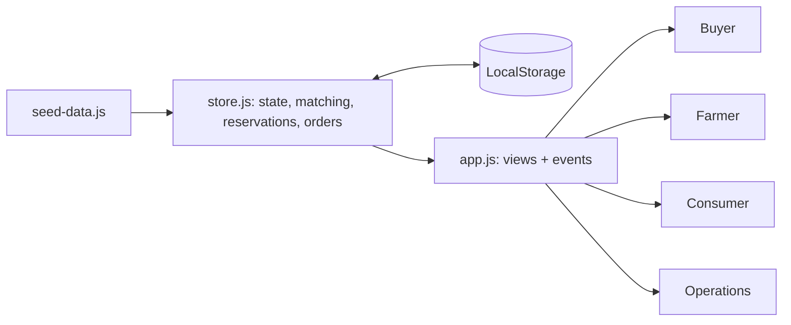

# Kisanity — market-access prototype (demo)

A static, no-backend prototype of a demand-first procurement flow: **buyer demand → matching → multi-farm aggregation → order → fulfilment**, plus a farmer workspace, a consumer marketplace on the same inventory, and an operations view.
**All data is fictional and stored only in your browser (LocalStorage).** No Kheyti integration, partnership, farmer data or real transactions are implied.

## Run locally
```
python3 -m http.server 8000   # then open http://localhost:8000
node tests/scenario.test.mjs  # store logic + view render checks
```
ES modules need http(s); opening `index.html` via `file://` will not work.

## Publish on GitHub Pages
1. Push this repository's contents to the `main` branch, with `index.html` at the repository root.
2. In Settings → Pages, choose **Deploy from a branch**, then select `main` and `/(root)`.
3. Open the Pages URL and run the walkthrough below. Hash routing (`#/buyer`) means refresh works on any path.

## 3-minute walkthrough
1. **Buyer** → submit the prefilled request (500 kg Tomato, grade A).
2. The proposed allocation shows three farms: 150 + 200 + 150 kg. **Confirm allocation.**
3. **Farmer** → pick Farm A / B / C: the commitment appears and available stock drops.
4. **Buyer** or **Operations** → *Advance (demo)* through the timeline; *Delivered* moves committed stock to delivered.
5. **Consumer** → add produce, check out; stock shrinks for everyone. *Reset demo data* restores the seed.

## Architecture

Quantities: *available = total − committed − delivered*. Every order confirmation validates all lots before reserving any.

## Implemented vs planned
- **Implemented:** procurement requests with validation, greedy cheapest-first matching (product, grade, date, price target, stock), partial allocation with shortfall, reservation safety, cancellation release, 7-step fulfilment, farmer listings/commitments, consumer cart and checkout, ops tables, persistence and reset.
- **Planned / not built:** location feasibility in matching, delay alerts and exception queue, consumer location selector and search box (category filter only), product images, B2G, real payments/logistics/quality data, market intelligence.
- **Condensed:** CSS is two files (`tokens.css`, `app.css`) and logic lives in `store.js` rather than many modules.

## Production would need
A transactional backend (concurrent reservation safety), real authentication, payments and settlement, logistics and quality-check integrations, and verified farmer/buyer onboarding.
